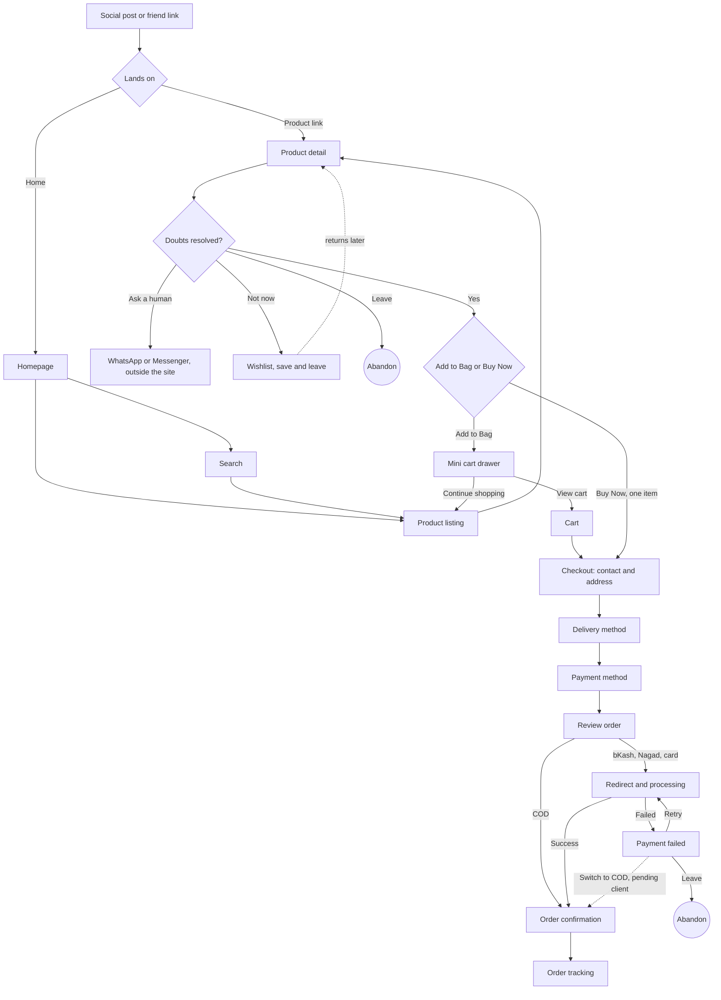

# Information architecture: ELARA

Built from `brief-interrogated.md`, `engagement.md` and `context.md`. User behaviour comes from synthetic research and is unvalidated. Mobile 390px is designed first; desktop 1440px adapts from it.

## Part 1: The journey

**Who is travelling:** a woman, 22 to 40, mostly Dhaka-based, buying for herself. She both decides and pays, so I follow her. Outside-Dhaka shoppers take the same journey with more doubt about delivery and COD.

**Where it starts:** not on the site. It starts on Instagram, Facebook or TikTok, or with a friend's bag, and she lands on ELARA already holding one product in mind. The first screen is usually a product page, not the homepage.

**Primary journey: first purchase of a bag**

1. **Arrive from outside.** She taps a post or a shared link. *Wants to know:* is this the bag I saw?
2. **First look.** Lands on a product page (or the homepage). *Decision:* stay, or leave. Leave = abandon.
3. **Browse or search** if the bag she saw is not what she wants, or she came to the homepage. *Wants:* similar bags, by type, colour, price.
4. **Evaluate the bag.** Photos from several angles, size in cm, material, interior, colour, reviews. *Wants to know:* will it match the photo, is the quality good, will it fit my things?
5. **Resolve remaining doubt.** Delivery charge and time, return and exchange rule, real contact. *Decision:* doubts gone, continue; not gone, then ask a human (WhatsApp or Messenger), save it, or leave.
6. **Save for later.** Most do not buy on first sight. *Branch:* save to Wishlist and leave, come back in about two days (see step 14).
7. **Choose how to buy.** Pick colour, size, quantity. *Decision:* **Add to Bag** (keep shopping) or **Buy Now** (one item, straight to checkout).
8. **Review the bag** (Add to Bag path only). Mini cart, then cart: quantities, save for later, subtotal, delivery threshold. *Decision:* continue shopping, or checkout.
9. **Give contact and address.** Guest by default. Bangladesh address: Division, District, Upazila/Thana, Area. *Abandon risk:* forced account creation, an address form that does not fit her area.
10. **Choose delivery and payment.** Delivery charge appears by address (Dhaka ৳60, outside ৳120, free over ৳3,000). *Decision:* COD, bKash, Nagad or card. *Abandon risk:* a charge she did not expect.
11. **Pay and place the order.** COD places it directly. bKash, Nagad and card leave for the gateway and return. *Branches:* success; **failed**, then retry (and, pending client decision, switch to COD).
12. **Confirm.** Order number, items, total, delivery estimate, address. *Ended well:* she is sure the order exists and knows when it arrives.
13. **Track the order.** She checks status until it arrives. Works without an account (order number and phone).
14. **Come back later** (from step 6). Returns from Wishlist or recently viewed, and re-enters at step 4 or 7.

**Ended well:** the bag arrives, matches the photo, and she would order again. The product ends outside its screens; the screen's job ends at confirmation and tracking.

**Other journeys, one line each:**
- **Search-led:** types "black leather bag", scans results, enters at step 4.
- **Return visitor:** opens Wishlist, moves an item to the bag, enters at step 7 or 8.
- **Buy Now:** step 7 straight to step 9, existing bag untouched, summary labelled "Buy Now Item".

### User flow



### Sitemap

```
ELARA
├── Home
├── Bags (Product listing)
│   ├── Handbags
│   ├── Tote
│   ├── Shoulder
│   ├── Crossbody
│   ├── Mini
│   ├── Travel / Work
│   └── Premium leather
│   [filters: Category, Price, Color, Material, Size, Availability]
│   [sort: Featured, Newest, Price low-high, Price high-low, Best selling]
├── New Arrivals
├── Collections (e.g. The Everyday Collection)
├── Best Sellers
├── Product detail (per product)
├── Search (overlay, then results)
├── Wishlist
├── Cart (plus mini-cart drawer)
├── Checkout (5 steps, plus payment states)
│   └── Order confirmation
├── Order tracking (guest by order number and phone, or from Account)
├── Account (login, profile, orders, saved addresses, wishlist, logout)
├── About (brand story, craftsmanship)
├── Contact
└── Info pages (Shipping and delivery, Returns and exchange, Privacy, Terms)
```

## Part 2: Screen inventory, derived from the journey

Each entry names the step it serves.

**Discover and browse**
- `Homepage`: brand story, new arrivals, categories, collection, best sellers, social proof, newsletter (serves steps 2, 3)
- `Product Listing`: browse and narrow by filter and sort without losing place (serves step 3)
- `Product Listing, no results`: empty state with suggestions (serves step 3)
- `Search overlay`: recent, popular, suggested products (serves step 3)
- `Search results`: results and no-results state (serves step 3)
- `Quick view`: card-level look and quick add, without leaving the list (serves steps 4, 7)
- `Homepage: Spotlight`: a curated, rotating pick of 5 products (2 small + 1 large + 2 small thumbnails; selecting a thumbnail swaps which product is large and shown with detail). Added 2026-09-23, designer's decision — not in the original brief. Serves steps 3, 4: a faster path than New Arrivals for a shopper who wants one considered recommendation instead of browsing. **Open naming and scope decisions below.**

**Evaluate and trust**
- `Product Detail`: gallery, price, rating, colour, size, quantity, Add to Bag, Buy Now, Wishlist, delivery charge and time (serves steps 4, 5, 7)
- `Product detail sections`: materials, dimensions, interior, care, reviews, shipping and returns, as expandable parts of the PDP (serves steps 4, 5)
- `Size and dimensions sheet`: size in cm with a real-object comparison (serves step 4)
- `Contact`: WhatsApp and Messenger, phone, address, expected reply time (serves step 5)
- `About`: brand story, craftsmanship (serves step 5)
- `Shipping and delivery`, `Returns and exchange`, `Privacy`, `Terms`: plain-language policy pages (serves step 5)

**Save and return**
- `Wishlist`: saved products, path to Add to Bag (serves steps 6, 14)
- `Wishlist, empty`: empty state (serves step 6)

**Buy**
- `Mini cart drawer`: added item, Continue Shopping, View Cart, Checkout (serves steps 7, 8)
- `Cart`: items, quantity, remove, save for later, subtotal, delivery, total (serves step 8)
- `Cart, empty`: empty state (serves step 8)
- `Checkout, contact`: name, phone, email, guest by default (serves step 9)
- `Checkout, shipping address`: Bangladesh address structure (serves step 9)
- `Checkout, delivery method`: charge by address (serves step 10)
- `Checkout, payment method`: COD, bKash, Nagad, card (serves step 10)
- `Checkout, review order`: summary, "Buy Now Item" label when relevant (serves steps 10, 11)
- `Payment processing`: redirect and waiting (serves step 11)
- `Payment failed`: reason from gateway, Retry (serves step 11)
- `Order confirmation`: order number, items, total, estimate, address, Track Order (serves step 12)

**After the order**
- `Order tracking`: status by order number and phone (serves step 13)
- `Account`: login or sign up, profile, orders, saved addresses (serves steps 13, 14)

### Check 1: screens that serve no step in Part 1

- **`Account, payment methods`** (the brief asks for it). No step in the journey strictly needs it, but the designer decided to **keep it** because the client brief lists it. Scope: a saved preferred payment method (COD, bKash, Nagad or card) that pre-selects at step 10, plus a masked bKash or Nagad number for reference. Card numbers are never stored by ELARA's screens; saved cards only if the chosen gateway supports tokenised cards (OPEN until the gateway is chosen).
- **`Account, profile`** serves step 13 and 14 only weakly. It stays because the brief lists it, but it is low priority.

### Check 2: steps in Part 1 with no screen

- **Step 1, arrive from a social post.** Happens outside the product. The consequence is that every product page must work as a landing page with a stable link.
- **Step 5, ask a human.** WhatsApp and Messenger open outside the site. The site only needs a visible contact button and a stated reply time.
- **Step 11, approving a bKash or Nagad payment.** Happens in the gateway or wallet app; not our screens. This is why the gateway choice matters.
- **After delivery: a return or exchange request.** The journey says the bag must match the photo, and the research says wrong colour or size is the top complaint, but **no screen lets her ask for an exchange**. The brief only asks for a returns *policy*. This is a gap: ask the client whether a request flow is wanted (new scope) or the policy page tells her to contact them.

## Part 3: Navigation pattern

**Constraint from the brief:** avoid complicated navigation, no excess. Header content required: Logo, New Arrivals, Bags, Collections, Best Sellers, About, Search, Account, Wishlist, Cart.

**Mobile 390px**
- **Top bar:** menu, logo, search, bag. Menu opens a full-height **drawer** with categories, collections, About, Contact, Account, Wishlist.
- **No bottom tab bar.** The product page carries a sticky bottom Add to Bag and Buy Now, and checkout carries its own primary button. A tab bar would compete with both.
- **Wishlist and Account** live in the drawer and as small icons where space allows.
- **Mini cart** is a bottom sheet after Add to Bag.
- **Checkout** strips the site header down to logo and a step indicator (Contact, Address, Delivery, Payment, Review). One task per screen, with a back button.

**Desktop 1440px**
- **Header:** logo left, main links (New Arrivals, Bags, Collections, Best Sellers, About), then search, wishlist, account, bag right. **Bags** opens a light dropdown of categories, no mega-menu.
- **Mini cart** is a right-side drawer.
- **Breadcrumbs** on listing and product pages.
- **Checkout:** two columns, form on the left, order summary on the right. Header reduced to logo and a "Continue shopping" link.

**Why this fits the journey:** shoppers arrive deep in the site and leave again, so every product page carries the header and a sticky purchase action. Checkout removes distractions because abandonment there is expensive.

## Part 4: Content hierarchy per screen

Hierarchy only; layout is a later step. Three levels maximum.

**Product Detail** (the decision screen)
- *Primary:* the product gallery, with the name and price beside or above it, and Add to Bag and Buy Now.
- *Secondary:* colour, size, quantity; delivery charge and time; rating; the most important facts in one line (material, dimensions).
- *Tertiary:* full description, interior details, care, returns, reviews with customer photos, related products, WhatsApp contact.

**Product Listing**
- *Primary:* the product grid (image, name, price).
- *Secondary:* filters and sort, result count.
- *Tertiary:* colour swatches, labels (Best Seller, New), wishlist heart, quick view.

**Homepage** — section order, corrected 2026-09-23 to match what's actually being built (not the earlier my-home-screen.html mockup): Hero → New Arrivals (filter pills: Best Sellers, New Arrivals, Limited Edition, Accessories — **Best Sellers is a filter here, not its own section**) → Shop by Category (4 of 5, see below) → **Spotlight** → Brand Story → Reviews → Newsletter → Footer. **There is no separate "Featured Collection" or "Best Sellers" section** — both were only in the early reference mockup and are dropped.
- *Primary:* the hero image, one headline, one CTA ("Shop New Collection").
- *Secondary:* New Arrivals (with its filter pills), Shop by Category, Spotlight.
- *Tertiary:* Brand Story, social proof (Reviews), Newsletter, Footer.

**Homepage: Spotlight** (new section, designer's decision, 2026-09-23)
- *Primary:* the large product panel — image, name, and the CTA (see decision below).
- *Secondary:* the 4 smaller thumbnails either side; the selected one's price and one-line description.
- *Tertiary:* rating, if shown at all.

**Cart**
- *Primary:* the items with quantity, and the total.
- *Secondary:* the delivery charge line, and the progress toward free delivery (৳3,000), and Proceed to Checkout.
- *Tertiary:* save for later, remove, promo, related products.

**Checkout, payment method step**
- *Primary:* the four payment options, with COD clearly "Available".
- *Secondary:* the order summary with the delivery charge shown separately.
- *Tertiary:* the security and refund note.

**Checkout, review order (Buy Now)**
- *Primary:* the "Buy Now Item" label, the single product, and the total.
- *Secondary:* address, delivery estimate, payment method.
- *Tertiary:* edit links, terms.

**Payment failed**
- *Primary:* what happened, in plain words, and the Retry button.
- *Secondary:* the reassurance that no money was taken (if true), and the other payment options.
- *Tertiary:* contact and help.

**Order confirmation**
- *Primary:* "Order placed" and the order number.
- *Secondary:* items, total, delivery estimate, address, Track Order.
- *Tertiary:* create an account, continue shopping.

**Order tracking**
- *Primary:* the current status and the expected delivery date.
- *Secondary:* the step-by-step status history and the order details.
- *Tertiary:* contact and help.

## Open questions this raises

1. **`Account, payment methods`**: kept (designer's decision). Confirm with the gateway choice whether saved cards are possible.
2. **Return or exchange request screen**: decided with the client, out of scope. The Returns and exchange page states the policy and offers Contact Us / Message Us; the request process is handled in development.
3. **Contact channel:** decided with the client. Primary is WhatsApp, with an email option. Reply target is within 1 business day. Note: the synthetic research suggests shoppers value fast replies (an hour or so), so the page states the real promise ("we reply within 1 business day") and does not imply faster.
4. **Guest order tracking:** decided. A guest tracks an order with order number plus phone number; no account is required.
5. **Value Proposition / Trust Bar, added 2026-09-24, designer's decision — not in the original brief.** Eyebrow + headline, then 3 icon+title+line commitments, then supporting photography, then one CTA. Serves step 5 (resolve remaining doubt) earlier and more visibly than waiting for the PDP trust-strip. **Position: decided — after Brand Story, before Reviews.** Reasoning: Brand Story gives the emotional case (why), the Trust Bar gives the concrete promises (what), Reviews gives peer proof (who else agrees) — a deliberate sequence, not arbitrary. **Content corrected from the reference it's based on:** "Free Worldwide Shipping" does not apply — ELARA ships within Bangladesh only (`engagement.md`); the line must say "Nationwide Delivery" or equivalent. "Secure Payment" is named specifically (bKash, Nagad, Card, COD) rather than left generic, since those are the exact methods `context.md` says shoppers already recognise and trust.
7. **Shop by Category, decided 2026-09-23:** the homepage shows only **4 of the 5 categories** (Tote, Shoulder, Crossbody, Mini — **Work is left out**), staggered at alternating heights, real photography, no card box. "See all" goes to the full Product Listing with all 5 (and Work) as filters. **Open:** which 4 are featured is not yet ruled — ask the client whether it is fixed, rotates by season, or follows sales data, same content-ops question as Spotlight below. Until answered, the 4 shown here are a placeholder choice, not a commitment. **Mobile layout deferred** — desktop is being built first; the zigzag rhythm breaks under simple stacking, so mobile needs its own pass (horizontal scroll to keep the rhythm, or a different pattern) before this section is called done, not skipped.
8. **Spotlight section, added 2026-09-23:**
   - **Name: decided — "Spotlight".** No freshness promise, so it stays honest even if the 5 products don't rotate weekly.
   - **Position: decided — right after Shop by Category.** Homepage order, current: Hero → New Arrivals → Shop by Category → **Spotlight** → Brand Story → **Value Proposition / Trust Bar** → Reviews → Newsletter → Footer. (Earlier notes about a "Featured Collection" section were wrong — that only existed in the early reference mockup; it isn't part of what's actually being built. Correction made 2026-09-23.)
   - **CTA behaviour: decided 2026-09-23.** The large panel's button goes to the full PDP — it does not check out. **The button must be labelled "View Details" (or "Shop This"), never "Buy Now."** "Buy Now" already has a fixed meaning on this project — one click, straight to checkout, cart untouched (`engagement.md`) — and reusing that exact label for a button that instead opens the PDP breaks the pattern a shopper just learned there. The first build used "Buy Now (Tk.4,500)" with this PDP-link behaviour; that label needs correcting in Figma before this ships.
   - **Total pool: decided — 5 products** (corrected 2026-09-23; an earlier answer said 8, superseded). All 5 shown at once (2 small + 1 large + 2 small); the "3/5"-style counter and prev/next arrows step through which one is large, not through a longer hidden list.
   - **Content ops:** who picks the 5 products, in what order, and how often — this is a content question for Nadia, not a design one.
9. **Testimonial auto-scroll (marquee), requested 2026-09-24.** The designer wants the two testimonial rows to auto-scroll continuously in opposite directions, overriding the recommended scroll-triggered reveal. Flagged risk: conflicts with restrained-motion (never stops, per-review reading time is short before a card scrolls away, no evident pause control for WCAG 2.2.2). **Deferred — the designer will build this in the final motion/interaction pass, not now.**
